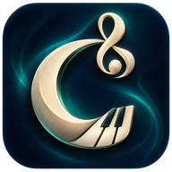

# Cadenza

A local experimental AI classical composer. Generate eight fresh candidates, select one, listen with recorded instruments, and export MIDI or M4A. No API key or account is required to compose.

[Download the desktop app](https://github.com/BugByteDev/Cadenza/releases/latest)

## Desktop: Windows and Linux

The Windows and Linux desktop packages include Python, Node, the trained models, recorded instruments, and an M4A encoder. No separately installed runtimes are needed.

- **Windows x64:** download `Cadenza-Windows-x64-Setup.exe` and install for your user account. The portable ZIP also works: extract it and open `Launch Cadenza.vbs`.
- **Linux x64:** extract `Cadenza-Linux-x64.zip` and run `Cadenza/install.sh` to add an application-menu shortcut, or run the `Cadenza` executable directly. Built on Ubuntu 22.04; requires a graphical desktop and glibc 2.35 or newer.
- **Linux ARM64:** use `Cadenza-Linux-arm64.zip`. Built on Ubuntu 24.04; requires glibc 2.39 or newer and a graphical desktop.
- **macOS:** the existing macOS download uses installed Python with Tk, Node 22+, and FFmpeg. This is not yet a self-contained Mac package.

Supported targets are modern 64-bit desktop systems. Older operating systems, 32-bit computers, and every Linux distribution are not guaranteed. Windows ARM is not a native build target. Packaged builds are checked for native GUI startup, fresh neural generation, MIDI output, piano/orchestral rendering, M4A encoding and decoding, and SDL audio initialization. CI audio uses a dummy audio device; physical speaker playback must still be checked on your computer. Packages are unsigned.

To run from source, install Python 3.11+ with Tk, Node 22+, FFmpeg, and `pygame`, then run `python desktop.py`. Runtime source and redistribution notices are included in the desktop packages.

The interface reflows and scrolls in small windows. Generated MIDI, note JSON and M4A are saved automatically to your library: `%LOCALAPPDATA%/Cadenza/generated` on Windows, `~/Library/Application Support/Cadenza/generated` on macOS, and `$XDG_DATA_HOME/Cadenza/generated` (or `~/.local/share/Cadenza/generated`) on Linux. Save buttons copy files to your chosen location. No premade songs are shipped as app generation resources.

## Dependencies and first launch

Packaged Windows and Linux apps include their dependencies. Install, open Cadenza, and click Generate. The app checks its dependencies at startup; missing tools open a setup dialog with installation links, a Pygame install button and a Check again button. Damaged packaged downloads offer reinstall guidance.

For source or the current macOS app, see [the complete dependency list and setup commands](DEPENDENCIES.txt): Python 3.11+ with Tk, Node 22+, FFmpeg and Pygame 2.6.1. If Python itself is missing, the source launcher provides setup guidance. Restart Cadenza after installing tools so PATH changes take effect.

## Models and training

The main music model has 201,700 parameters, two 384-unit tanh hidden layers and eight events of context. Six output heads predict pitch, onset gap, duration, velocity, harmony root and chord quality. A separate 182,922-parameter word model generates titles. Learned inference is combined with musical-form rules, accompaniment rules and heuristic selection; this is not a concert-level long-context composer or a trained aesthetic judge.

The general model was fine-tuned on 1,870 MIDI performances/parts, with 220 validation and 249 test files, from MAESTRO v3 plus composer-exclusive public-domain Mutopia supplements. The additional archive contains 2,666 unique MIDI files from 1,110 editions credited to 227 composers; parts and movements are not counted as full works. Six instrument models were trained from scratch with composer-disjoint splits: violin, cello, flute, strings, clarinet and bassoon. Harp uses the general model because independent labelled data was insufficient. String evaluation covers few composers. Lower event loss does not establish better music.

Reports, dataset fingerprints and per-edition provenance are included. Read [MODEL_CARD.md](MODEL_CARD.md) for limitations. MIDI fragment screening reduces exact short-fragment reuse; it does not guarantee that melodies never resemble existing music.

## Sounds and licenses

- Code: MIT, see `LICENSE`.
- Main music weights: supplied under CC BY-NC-SA 4.0 for noncommercial experimentation; MAESTRO is provided under that license. See `MODEL_LICENSE.md`.
- MAESTRO: [official source](https://magenta.tensorflow.org/datasets/maestro); Hawthorne et al., *Enabling Factorized Piano Music Modeling and Generation with the MAESTRO Dataset*, ICLR 2019.
- Mutopia: public-domain editions with retained per-edition provenance. Dickinson title-training source: [Project Gutenberg](https://www.gutenberg.org/ebooks/12242).
- Piano: recorded Yamaha C5 by Alexander Holm, CC BY 3.0. One sampled velocity layer, minor-third sample spacing, direct non-looping playback with natural decay. Converted to mono PCM, limited to eight seconds with boundary fade.
- Other instruments: GeneralUser GS by S. Christian Collins, complete license in `sounds/`. Portable rendering uses SpessaSynth Core (Apache-2.0); archive decoder fflate (MIT). Dependency licenses are retained in `dist/vendor/`.

## Development

`npm ci --ignore-scripts`, `node verify.mjs`, and `python3 portable_smoke.py`. Source rebuild uses NumPy: `python3 collect_repertoire.py`, `python3 train.py --epochs 30 --hidden 384 --init dist/general-initial.json`, then `python3 train_titles.py`. Training downloads the MAESTRO MIDI archive into RAM and needs several GB of RAM. Python inference is orchestrated by the native UI; the learned JS inference and SoundFont engine use Node.

GitHub Actions includes a desktop compatibility matrix and reproducible desktop release builds. The source release contains no authentication files or generated personal library. The desktop release workflow builds bundled Windows and Linux apps on native OS runners.
